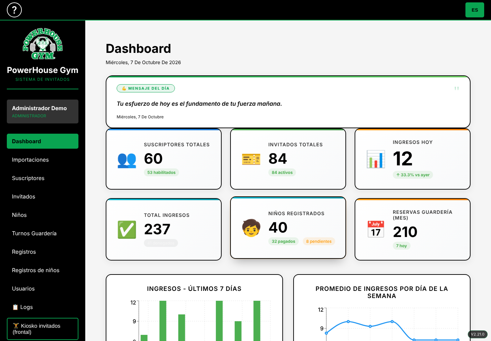
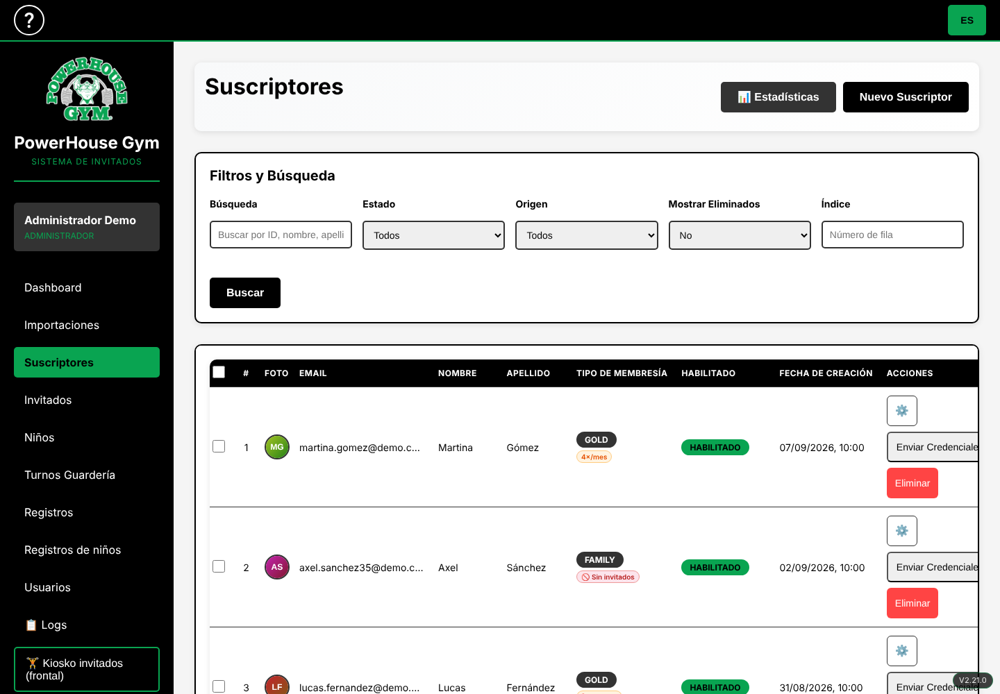
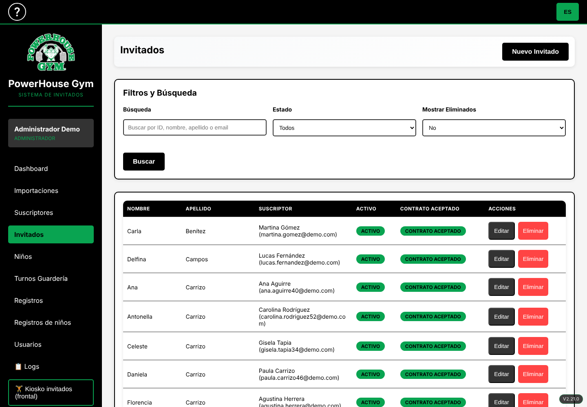
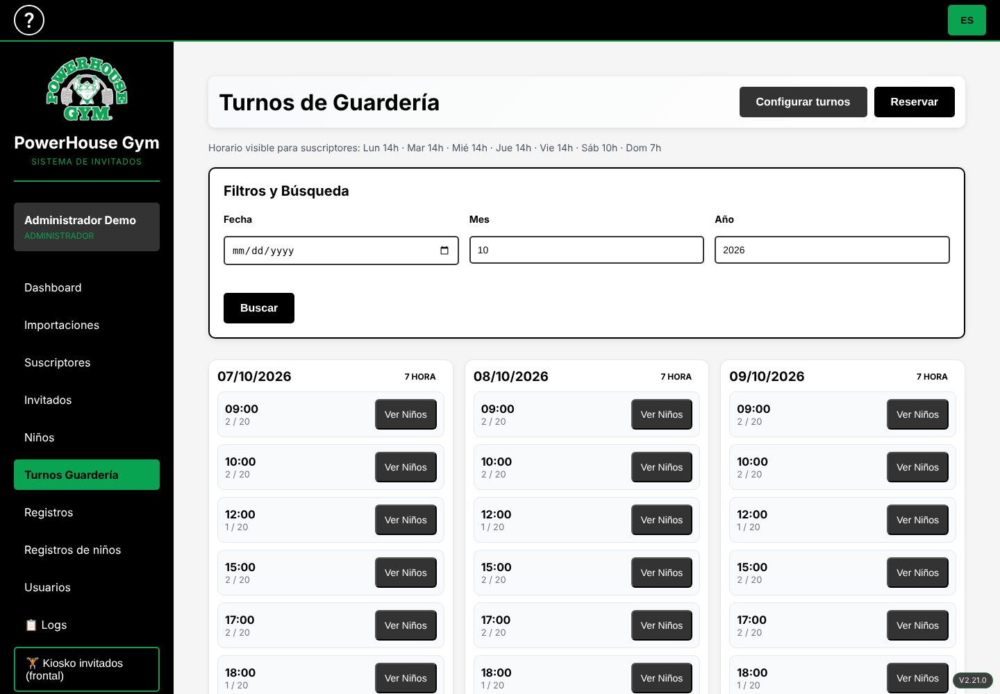
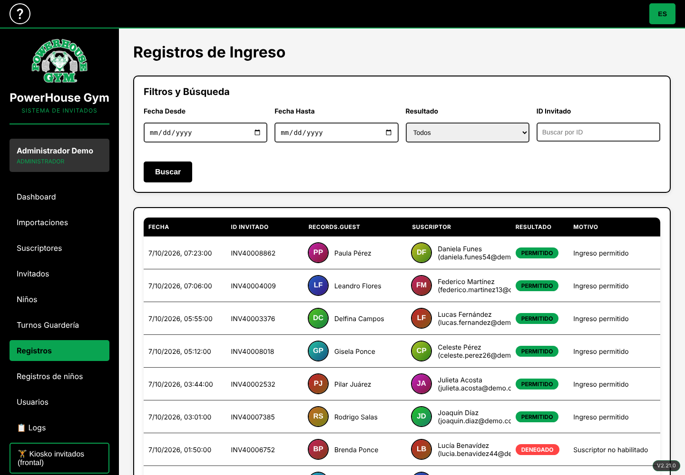
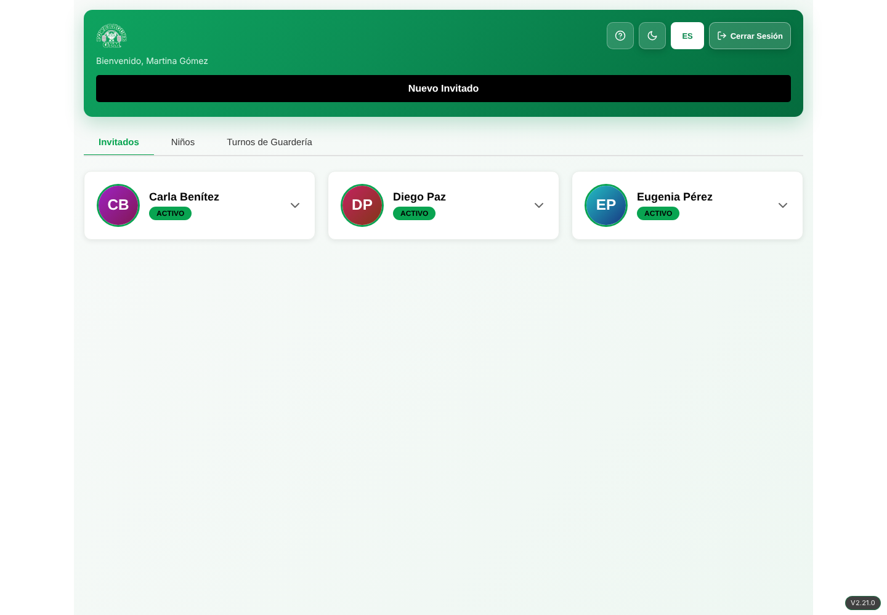
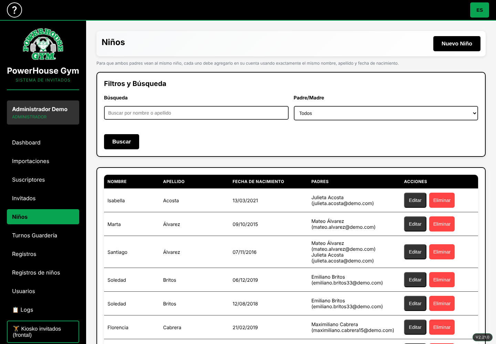
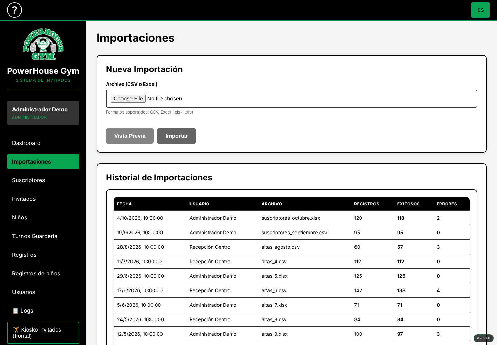
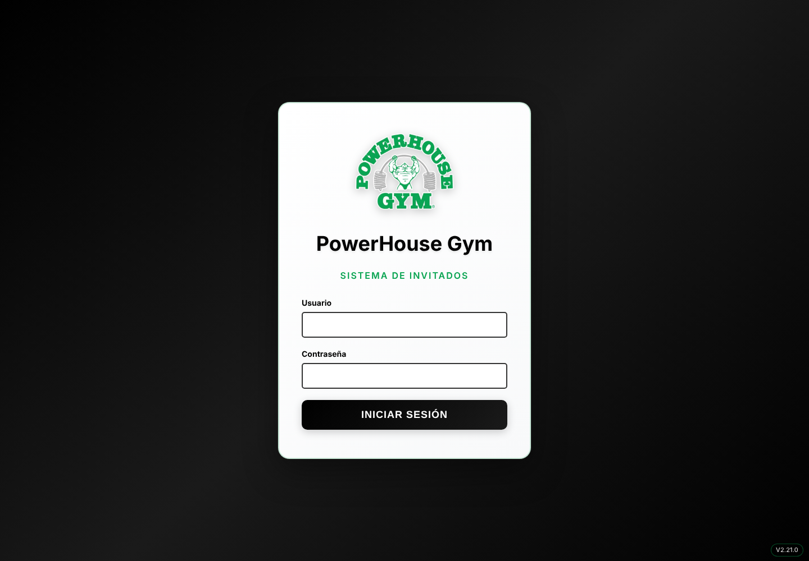

# PowerHouse Gym Guest Management System

**Full-stack style web app for gyms: guest access control, QR/barcode check-in, daycare shift booking and a subscriber self-service portal. Built with React, TypeScript, Vite and an in-memory mock API, so the whole system runs with no backend and no database.**

> Resumen en español: sistema de gestión de invitados y guardería para un gimnasio. Panel de administración, portal de suscriptores, kiosco de ingreso con QR y turnos de guardería. Esta versión es una demo 100% frontend con datos simulados en memoria.

---

## Demo

| Admin dashboard | Subscribers | Guests |
|---|---|---|
|  |  |  |

| Daycare shifts | Entry records | Subscriber portal |
|---|---|---|
|  |  |  |

| Children | CSV imports | Login |
|---|---|---|
|  |  |  |

---

## Key Features

- **Admin panel** with KPIs, entries per day, average entries by weekday, motivational message of the day and an audit log.
- **Subscriber management**: membership types (Gold, Silver, Family, FMS), guest policy per subscriber, enable / disable, soft delete, credentials by email and bulk **CSV / XLSX import** with error reporting.
- **Guest management**: guest profiles with photo, waiver acceptance, QR code and barcode generation, activation status.
- **Access control kiosk**: validate guest entry by ID, QR scan (`html5-qrcode`) or barcode, with allowed / denied feedback and sounds.
- **Daycare module**: children linked to one or more subscribers, payment status, configurable weekly availability, shift capacity, reservations and check-in / check-out tracking.
- **Subscriber self-service portal**: subscribers manage their own guests, children and daycare reservations.
- **Role-based access**: administrator and reception roles with different permissions.
- **Internationalization**: Spanish and English UI.
- **Progressive Web App**: installable, with service worker and web manifest.
- **Responsive design** for desktop, tablet and mobile kiosks.

---

## Key Technical Highlights

### 1 · Zero-backend demo through an Axios adapter

Every HTTP call made by the app is intercepted by a custom Axios `adapter` and resolved by an in-memory router. The UI code is identical to the one that would talk to a real REST API.

```typescript
export const installAxiosMock = (instance: AxiosInstance) => {
  instance.defaults.adapter = async (config) => {
    await delay(120 + Math.random() * 180);            // realistic latency
    const res = handleMock(config.method, config.url, config.params, config.data);
    if (res.status >= 200 && res.status < 300) return buildResponse(res, config);
    throw new AxiosError(res.data?.error, String(res.status), config, {}, buildResponse(res, config));
  };
};
```

### 2 · A small REST router with ~55 endpoints

`src/mock/handler.ts` implements authentication, subscribers, guests, children, daycare shifts and reservations, entry validation, logs and imports. It parses JSON and `FormData` bodies, supports filtering, pagination and soft deletes, and mutates a shared in-memory store, so creating or editing records works end to end.

The entry validation route, for example, resolves the guest by ID, QR or barcode, checks the subscriber status and enforces a monthly guest limit before writing the entry record and the audit log:

```typescript
if (!s || !s.habilitado) return deny('The subscriber is not enabled today', { invitado: invInfo });
if (s.reglamentoInvitados === 'limitado') {
  const n = db.registros.filter((r) => r.permitido && r.suscriptor === s.id && sameMonth(r.fecha)).length;
  if (n >= 4) return deny('Monthly guest limit reached (4)', { invitado: invInfo });
}
db.registros.unshift({ id: uid('reg'), invitado: inv.id, suscriptor: s.id, permitido: true, fecha: iso() });
```

### 3 · Deterministic, date-relative seed data

Demo data (60 subscribers, 90 guests, 40 children, ~280 entry records, ~420 daycare reservations, 300 audit logs) is generated relative to *today*, so dashboards and calendars always look alive. Avatars are generated as inline SVG data URIs, so there are no image assets or external services.

---

## Architecture

```
React 18 + TypeScript (Vite)
  |
  |-- pages/ (Dashboard, Suscriptores, Invitados, Ninos, Turnos, Registros, Kiosco...)
  |-- contexts/ (Auth, SuscriptorAuth, Language, Toast)
  |
  |-- services/api.ts  --- Axios instance ---+
  |                                           |
  |                       mock/install.ts  (Axios adapter + fetch override)
  |                                           |
  |                       mock/handler.ts  (REST router, ~55 routes)
  |                                           |
  |                       mock/seed.ts     (in-memory demo data)
```

---

## Tech Stack

| Layer | Technology |
|---|---|
| Frontend framework | React 18, TypeScript, Vite |
| Routing and data | React Router 6, React Query, Axios, React Hook Form |
| Charts | Recharts |
| QR and barcodes | html5-qrcode, react-qr-code, react-barcode |
| PWA | vite-plugin-pwa, Workbox, Web App Manifest |
| i18n | Custom Language Context (ES / EN) |
| Styling | CSS modules per page, responsive layout, CSS animations |
| Testing the UI without a backend | In-memory REST mock (Axios adapter) |

---

## Getting Started

```bash
git clone https://github.com/<your-user>/<your-repo>.git
cd <your-repo>
npm install
npm run dev
```

Open `http://localhost:5173`.

| Area | URL | Credentials |
|---|---|---|
| Admin panel | `/login` | user `admin`, any password |
| Reception | `/login` | user `recepcion`, any password |
| Subscriber portal | `/suscriptor/login` | `martina.gomez@demo.com`, any password |

No environment variables, database or backend are required.

---

## What this solves

Gyms that allow guests need to know who enters, under which subscriber and whether that subscriber is allowed to bring guests, while also offering a childcare service with limited capacity. This project covers that workflow end to end: identity validation at the door, subscriber and guest administration, daycare scheduling and an audit trail.

> Portfolio / demo version: all data is fictional and generated in memory. Reloading the page restores the initial state.

---

## Keywords

React, TypeScript, Vite, SPA, Progressive Web App (PWA), REST API mocking, Axios, React Router, React Query, React Hook Form, Recharts, QR code, barcode scanning, role-based access control (RBAC), internationalization (i18n), responsive web design, dashboard, CRUD, CSV import, access control system, gym management software, booking system, front-end architecture.

**Suggested GitHub topics:** `react` `typescript` `vite` `pwa` `dashboard` `gym-management` `qr-code` `access-control` `axios` `react-query` `recharts` `i18n` `mock-api` `portfolio`
